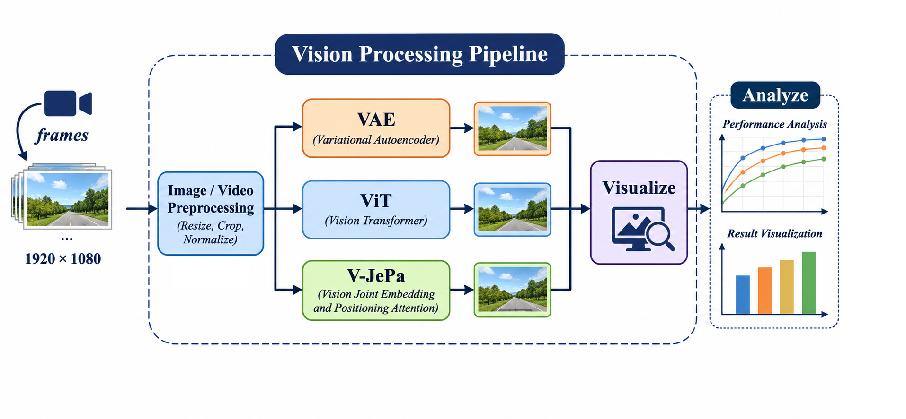
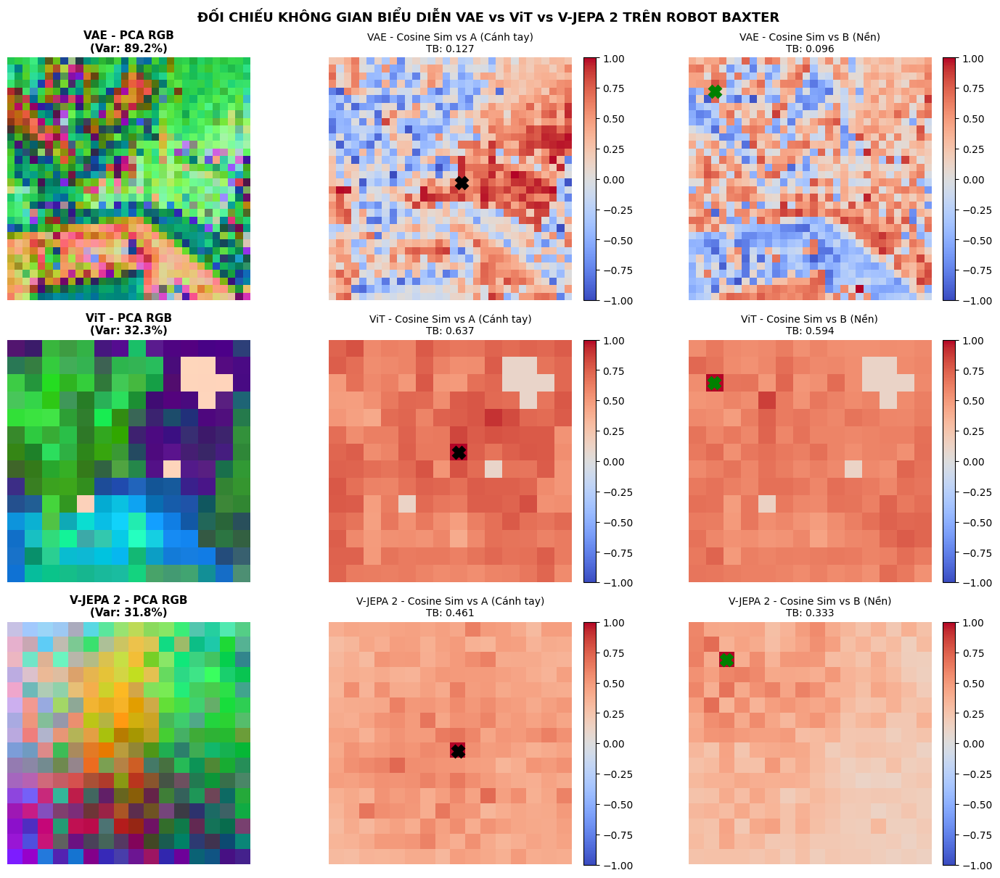
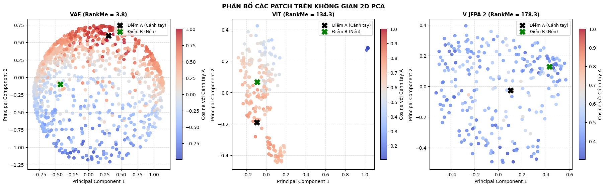

# 🤖 World Model Representation Benchmark: VAE vs. ViT vs. V-JEPA 2

[](https://www.python.org/)
[](https://pytorch.org/)
[](https://huggingface.co/)
[](https://opensource.org/licenses/MIT)
[](https://colab.research.google.com/)

> **Đề tài:** Nghiên cứu và đối chiếu không gian biểu diễn đặc trưng (*Latent Representation Space*) giữa ba trường phái học sâu trên bài toán cánh tay robot công nghiệp Baxter phục vụ **Mô hình Thế giới (World Model)** trong **Trí tuệ Nhân tạo Hiện thân (Embodied AI)**.  
> **Tác giả:** Phùng Nhật Minh ([@minhpntdc](https://github.com/minhpntdc))  
> **Repository:** [https://github.com/minhpntdc/Middle-Project](https://github.com/minhpntdc/Middle-Project)  
> **Notebook thực nghiệm chính:** [`notebooks/Phung_Nhat_Minh_BT_GK.ipynb`](notebooks/Phung_Nhat_Minh_BT_GK.ipynb)

---

## 📌 Mục lục
- [1. Đặt vấn đề & Động lực nghiên cứu](#1-đặt-vấn-đề--động-lực-nghiên-cứu)
- [2. Kiến trúc Quy trình (Vision Processing Pipeline)](#2-kiến-trúc-quy-trình-vision-processing-pipeline)
- [3. Ba Mô thức Biểu diễn Thị giác](#3-ba-mô-thức-biểu-diễn-thị-giác)
- [4. Bảng Đối chiếu Định lượng (Quantitative Benchmarks)](#4-bảng-đối-chiếu-định-lượng-quantitative-benchmarks)
- [5. Kết quả Trực quan Không gian (Visual Showcase)](#5-kết-quả-trực-quan-không-gian-visual-showcase)
- [6. Ba Khám phá Khoa học Cốt lõi](#6-ba-khám-phá-khoa-học-cốt-lõi)
- [7. Cấu trúc Dự án (Project Structure)](#7-cấu-trúc-dự-án-project-structure)
- [8. Hướng dẫn Cài đặt & Chạy Thực nghiệm](#8-hướng-dẫn-cài-đặt--chạy-thực-nghiệm)
- [9. Tài liệu Tham khảo (References)](#9-tài-liệu-tham-khảo-references)

---

## 1. Đặt vấn đề & Động lực nghiên cứu

Trong **Trí tuệ Nhân tạo Hiện thân (Embodied AI)** và điều khiển robot tự chủ, một **World Model** xuất sắc phải mã hóa được quy luật vận động vật lý của môi trường mà không bị phân tâm bởi các biến thiên ngẫu nhiên ở cấp độ điểm ảnh (*pixel noise, gợn sáng, bóng đổ*).

Dự án này đặt lên bàn cân 3 trường phái biểu diễn thị giác kinh điển:
1. **Mô hình Sinh nén Tái tạo Điểm ảnh (Pixel Reconstruction):** **VAE** (*Kingma & Welling, 2013*).
2. **Mô hình Tự chú ý Toàn cục Học có Giám sát (Supervised Transformer):** **ViT** (*Dosovitskiy et al., 2021*).
3. **Mô hình Tự giám sát Dự đoán Không gian Tiềm ẩn Video (Latent Predictive Architecture):** **V-JEPA 2** (*Assran, Bardes, LeCun et al., 2024*).

Thực nghiệm được thực hiện trên chuỗi khung hình video thao tác gắp-đặt (*pick-and-place*) của cánh tay robot công nghiệp Baxter trích xuất từ Wikimedia Commons.

---

## 2. Kiến trúc Quy trình (Vision Processing Pipeline)

Quy trình xử lý thị giác của dự án được thiết kế đồng bộ và khép kín qua 5 giai đoạn:

<p align="center">
  
</p>

```
  ┌────────────────┐
  │  Input Frames  │ (Baxter Robot 1920x1080 -> 75 frames 256x256)
  └───────┬────────┘
          ▼
  ┌───────────────────────────────┐
  │ Image / Video Preprocessing   │ (Resize, Center Crop, Tensor Normalization)
  └───────┬───────────────────────┘
          ├─────────────────────────┬─────────────────────────┐
          ▼                         ▼                         ▼
  ┌───────────────┐         ┌───────────────┐         ┌───────────────┐
  │      VAE      │         │      ViT      │         │   V-JEPA 2    │
  │ (sd-vae-ft)   │         │ (patch16-224) │         │ (vitl-fpc64)  │
  │  (32, 32, 4)  │         │ (14, 14, 768) │         │(16, 16, 1024) │
  └───────┬───────┘         └───────┬───────┘         └───────┬───────┘
          └─────────────────────────┼─────────────────────────┘
                                    ▼
                    ┌───────────────────────────────┐
                    │     Visualize Representations │
                    │ (PCA RGB, Cosine A/B, Scatter)│
                    └───────────────┬───────────────┘
                                    ▼
                    ┌───────────────────────────────┐
                    │  Analyze & Benchmark Metrics  │
                    │ (RankMe, Variance, Cosine Gap)│
                    └───────────────────────────────┘
```

---

## 3. Ba Mô thức Biểu diễn Thị giác

| Đặc tính So sánh | VAE (Kingma & Welling, 2013) | ViT (Dosovitskiy et al., 2021) | V-JEPA 2 (Assran, LeCun et al., 2024) |
| :--- | :--- | :--- | :--- |
| **Mô hình sử dụng** | `stabilityai/sd-vae-ft-mse` | `google/vit-base-patch16-224` | `facebook/vjepa2-vitl-fpc64-256` |
| **Mục tiêu tối ưu** | Tối đa hóa ELBO, tái tạo điểm ảnh (MSE) | Phân loại có giám sát ImageNet (Cross-Entropy) | Dự đoán đặc trưng tiềm ẩn che khuất (*Masked Latent Prediction*) |
| **Đầu vào xử lý** | Khung hình đại diện tĩnh ($256 \times 256$) | Khung hình đại diện tĩnh ($224 \times 224$) | Chuỗi 4 khung hình video ($4 \times 256 \times 256$) |
| **Lưới đặc trưng** | **$32 \times 32 \times 4$** | **$14 \times 14 \times 768$** | **$16 \times 16 \times 1024$** (Temporal Pooling) |
| **Cơ chế hoạt động** | Nén không gian qua tích chập hạ mẫu | 196 patch tokens tương tác tự chú ý toàn cục | Nén khối không-thời gian tubelets ($2 \times 16 \times 16$) |

---

## 4. Bảng Đối chiếu Định lượng (Quantitative Benchmarks)

Kết quả thực nghiệm đo đạc độc lập bằng các thước đo toán học chuẩn mực:

| Mô hình | Kích thước Grid | Số chiều ($D$) | Phương sai PCA 3PC (%) | Cosine TB Cánh tay (A) | Cosine TB Nền (B) | Hạng hiệu dụng RankMe |
| :--- | :---: | :---: | :---: | :---: | :---: | :---: |
| **VAE** | $32 \times 32$ | 4 | **89.19%** | 0.1267 | 0.0959 | **3.76** |
| **ViT** | $14 \times 14$ | 768 | 32.27% | 0.6370 | 0.5936 | 134.33 |
| **V-JEPA 2** | $16 \times 16$ | 1024 | 31.83% | **0.4611** | **0.3331** | **178.29** |

*Ghi chú các chỉ số:*
- **Điểm mỏ neo A (Chấm đỏ / Dấu X đen `x=0.55, y=0.50`):** Khớp cổ tay/kẹp gắp robot mang động học thao tác chủ động (*manipulator dynamics*).
- **Điểm mỏ neo B (Chấm xanh / Dấu X xanh lá `x=0.10, y=0.12`):** Phông nền phòng thí nghiệm tĩnh bất biến (*task-irrelevant context*).
- **Độ tương phản Cosine:** $\Delta_{\text{Cosine}} = \text{Sim}(A) - \text{Sim}(B)$. V-JEPA 2 đạt **$+0.1280$** (gấp gần **3 lần** so với $+0.0434$ của ViT).
- **Chỉ số Hạng Hiệu dụng RankMe (*Garrido et al., ICLR 2023*):** Tính entropy Shannon trên phổ giá trị kỳ dị SVD:  
  $$\text{RankMe}(X) = \exp \left( -\sum_{k=1}^K p_k \ln(p_k) \right) \quad \text{với} \quad p_k = \frac{\sigma_k}{\sum \sigma_i}$$

---

## 5. Kết quả Trực quan Không gian (Visual Showcase)

### 5.1. Bảng Đối chiếu 3x3 Không gian (Spatial Heatmaps)
<p align="center">
  
</p>

- **Hàng 1 (PCA Projections as RGB):**
  - *VAE:* Mô phỏng lại màu sắc gốc của ảnh nhưng lấm tấm nhiễu hạt do mục tiêu tái tạo điểm ảnh MSE.
  - *ViT:* Màu sắc chuyển đổi mịn hơn nhưng ranh giới giữa cánh tay kim loại và mặt bàn bị nhòe lẫn.
  - *V-JEPA 2:* **Tự phân đoạn đối tượng (Emergent Unsupervised Segmentation)**! Toàn bộ cánh tay robot Baxter được bóc tách thành một thực thể liền khối nổi bật trên nền phòng thí nghiệm dù không có 1 nhãn mặt nạ giám sát nào.
- **Hàng 2 (Cosine Similarity với Cánh tay A):**
  - *VAE:* Nhiệt độ chỉ sáng cục bộ tại vài pixel sát điểm A rồi suy giảm đột ngột.
  - *ViT:* Bản đồ bị "cháy sáng" bão hòa toàn ảnh do hiện tượng co cụm góc siêu cầu (*hyperspherical crowding*).
  - *V-JEPA 2:* Toàn bộ cánh tay cơ khí từ vai đến kẹp gắp đều sáng rực rỡ, nền bàn chìm sâu vào sắc xanh lạnh.
- **Hàng 3 (Cosine Similarity với Phông nền B):**
  - *V-JEPA 2:* Đồng nhất vùng phông nền phòng thí nghiệm và "khoét rỗng" dứt khoát bóng dáng cánh tay robot.

---

### 5.2. Đồ thị Phân bố 2D Đa tạp Tiềm ẩn (2D Patch Scatter Plot)
<p align="center">
  
</p>

- **VAE:** Các patch phân bố thành đám mây rời rạc, không chứa thông tin hình học ngữ nghĩa.
- **ViT:** Co cụm nén chặt thành khối cầu quanh gốc tọa độ. Điểm A và Điểm B nằm quá gần nhau, gây khó khăn cho việc phân biệt trạng thái thao tác.
- **V-JEPA 2:** Hình thành **hai nhánh đa tạp tách rời riêng biệt (*Disentangled Manifolds*)** giữa thực thể cánh tay (Điểm A) và môi trường nền (Điểm B), tạo khoảng phân cách hình học lý tưởng cho các bộ điều khiển trạng thái.

---

## 6. Ba Khám phá Khoa học Cốt lõi

1. **RankMe chứng minh V-JEPA 2 không bị sụp đổ biểu diễn (*Representation Collapse*):**  
   V-JEPA 2 đạt điểm số kỷ lục **178.29**, khai thác tối đa phổ giá trị kỳ dị của không gian Hilbert đa chiều, chứng minh việc dự đoán trong không gian tiềm ẩn kết hợp với *EMA Target Encoder* bảo tồn tối đa bậc tự do của dữ liệu.
2. **Khả năng tự nhận thức đối tượng vật lý qua chuỗi video (*Physical Object Discovery*):**  
   Nhờ huấn luyện dự đoán các khối không-thời gian che khuất trên video, V-JEPA 2 tự động phát hiện cánh tay robot là một thực thể vật lý độc lập với môi trường (*Bardes et al., 2024*).
3. **Kiểm chứng luận điểm World Model của Yann LeCun (2022):**  
   Thay vì lãng phí tài nguyên tính toán để tái tạo từng hạt pixel ngẫu nhiên như VAE, V-JEPA 2 lọc bỏ nhiễu hạt và chỉ bảo toàn cấu trúc động học bất biến, mở ra hướng đi cho **Lập kế hoạch trong không gian tiềm ẩn (Latent MPC)** thời gian thực cho robot tự chủ.

---

## 7. Cấu trúc Dự án (Project Structure)

```text
Middle-Project/
├── assets/
│   └── pipeline_architecture.png   # Sơ đồ Vision Processing Pipeline
├── configs/
│   └── config.yaml                 # Cấu hình siêu tham số và checkpoints
├── data/
│   └── raw/
│       ├── sample_image.jpg        # Khung hình đại diện Baxter (256x256)
│       └── sample_video.mp4        # Chuỗi video thao tác Baxter (75 frames)
├── notebooks/
│   └── Phung_Nhat_Minh_BT_GK.ipynb # Notebook thực nghiệm đầy đủ (Code + Kết quả + Phân tích)
├── outputs/
│   ├── 01_spatial_comparison.png   # Bảng so sánh 3x3 Heatmaps
│   ├── 02_patch_scatter.png        # Đồ thị phân tán đa tạp 2D
│   ├── 03_quantitative_metrics.csv # Bảng số liệu định lượng CSV
│   └── 04_research_report.md       # Báo cáo khoa học chi tiết
├── scripts/
│   ├── download_samples.py         # Tải dữ liệu Baxter & bộ sinh dự phòng
│   └── main_run.py                 # Pipeline thực thi chính toàn bộ dự án (CLI)
├── src/
│   ├── analysis/                   # PCA Reducer, Cosine Map, RankMe SVD
│   ├── data_loader/                # Xử lý ảnh và video tubelets
│   ├── models/                     # VAEWrapper, ViTWrapper, VJEPAWrapper
│   └── visualization/              # Trực quan hóa Heatmaps và Scatter
├── tests/
│   └── test_shapes.py              # Kiểm thử đơn vị (Unit Tests)
├── .gitignore                      # Bộ lọc tệp cho Git
├── requirements.txt                # Danh sách thư viện phụ thuộc
└── README.md                       # Tài liệu tổng quan dự án
```

---

## 8. Hướng dẫn Cài đặt & Chạy Thực nghiệm

### 8.1. Cài đặt Môi trường
Khuyến nghị sử dụng Python 3.10 hoặc 3.11:
```bash
# Clone repository
git clone https://github.com/minhpntdc/Middle-Project.git
cd Middle-Project

# Cài đặt các thư viện cần thiết
pip install -r requirements.txt
```

### 8.2. Chạy Kiểm thử Đơn vị (Unit Tests)
```bash
python tests/test_shapes.py
```

### 8.3. Thực thi Toàn bộ Pipeline qua CLI
```bash
# Bước 1: Chuẩn bị dữ liệu mẫu Baxter
python scripts/download_samples.py

# Bước 2: Chạy pipeline so sánh VAE vs ViT vs V-JEPA 2
python scripts/main_run.py
```
*Kết quả sẽ tự động được xuất ra thư mục `outputs/`.*

### 8.4. Chạy trên Google Colab
Bạn có thể mở trực tiếp file [`notebooks/Phung_Nhat_Minh_BT_GK.ipynb`](notebooks/Phung_Nhat_Minh_BT_GK.ipynb) trên Google Colab (chọn môi trường T4 GPU) để chạy tuần tự từng Cell và xem biểu đồ tương tác trực tiếp.

---

## 9. Tài liệu Tham khảo (References)

1. **Kingma, D. P., & Welling, M. (2013).** *Auto-Encoding Variational Bayes.* arXiv:1312.6114.
2. **Dosovitskiy, A., et al. (ICLR 2021).** *An Image is Worth 16x16 Words: Transformers for Image Recognition at Scale.* arXiv:2010.11929.
3. **LeCun, Y. (2022).** *A Path Towards Autonomous Machine Intelligence.* OpenReview.
4. **Assran, M., Bardes, A., et al. (2024).** *V-JEPA 2: Self-Supervised Video Models for Embodied Intelligence.* Meta FAIR.
5. **Garrido, Q., et al. (ICLR 2023).** *RankMe: Assessing The Downstream Performance without Training.* arXiv:2210.02885.
6. **Rombach, R., et al. (CVPR 2022).** *High-Resolution Image Synthesis with Latent Diffusion Models.*
